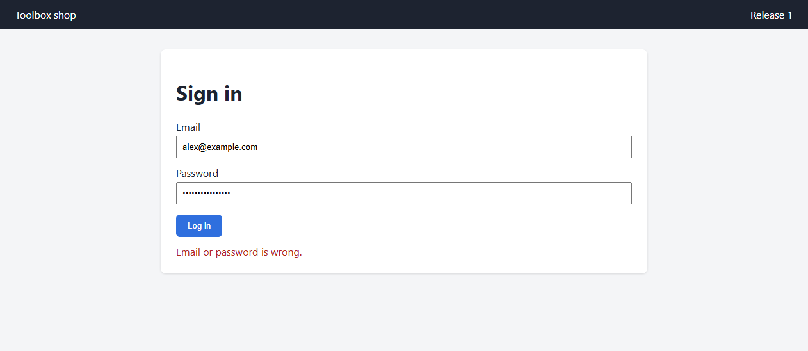
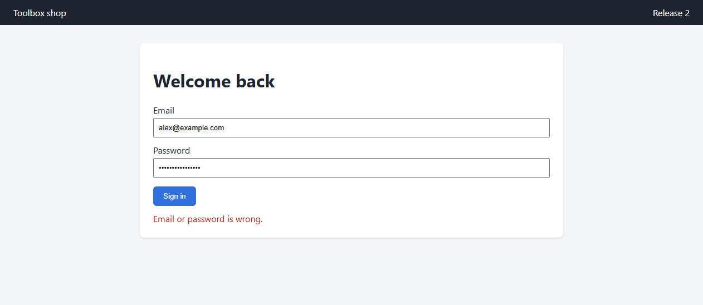
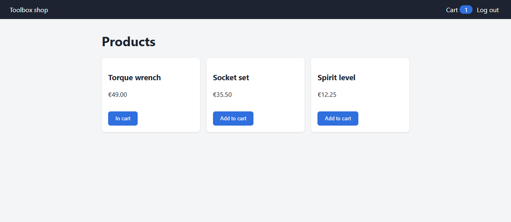
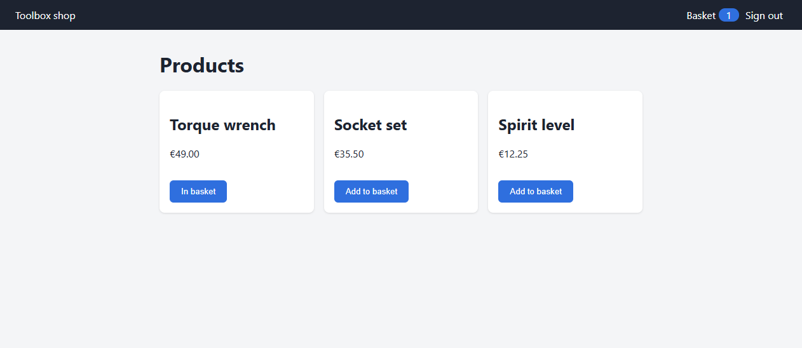
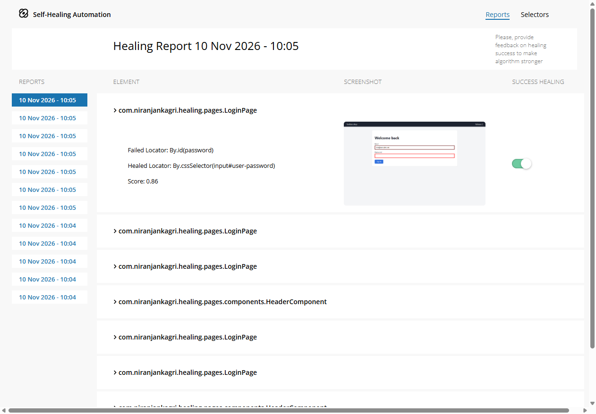

# Healenium self-healing tests

Selenium tests that keep running after a front-end redesign breaks their locators, using
[Healenium](https://healenium.io). The suite also shows where self-healing picks the **wrong** element, and how the
tests catch it.

A small demo shop ships two releases at the same URL. Release 2 renames or moves **every** locator the page objects
use. The same tests, through the same page objects, run three times:

| Step | Test class | Driver | Release | Result |
|---|---|---|---|---|
| 1. Learn | `Release1LearningTest` | Healenium | 1 | 6 journeys pass, nothing healed; Healenium saves each element it found |
| 2. Heal | `Release2HealingTest` | Healenium | 2 | 6 journeys pass; 18 out-of-date locators healed (3 known wrong heals pinned, see [Limits](#limits-found-on-real-runs)) |
| 3. Control | `Release2WithoutHealingTest` | plain ChromeDriver | 2 | 3 tests prove the old locators really fail without Healenium |

**15 tests, 0 failures**, about 1 minute locally (Java 21, Chrome 156, Healenium backend in Docker).

## What release 2 changed

| Release 1 (what the tests were written for) | Release 2 (after the redesign) |
|---|---|
|  |  |
|  |  |

| Element | Release 1 | Release 2 |
|---|---|---|
| Email, password | `#email`, `#password` | `#user-email`, `#user-password` |
| Sign-in button | `#login-button` "Log in" | `#sign-in-button` "Sign in" |
| Error box | `div.error-message` in the form | `div.form-alert[role=alert]`, form wrapped in a new `div.card` |
| Product card | `div.product-card` > `h3.product-name`, `button.add-to-cart` | `article.catalog-item` > `h2.item-title`, `button.btn-add`, inside a new `section` |
| Cart link and badge | `a.cart-link`, `.cart-count` | `a.basket-link`, `.basket-badge` |
| Log out | `#logout` | `#sign-out` |
| Cart | `#cart-items tr.cart-row td.item-name`, `#cart-total`, `#checkout` | `#basket-lines tr.basket-line td.line-name`, `#basket-total`, `#place-order` |
| Confirmation | `#order-confirmation`, `#order-number` | `#thank-you`, `#order-ref` |
| Amount paid | `#order-total` | `#order-total` (unchanged: no healing needed) |

## Healed locators (real run)

From `scripts/healing-summary.sh`, which turns Healenium's log lines into this table (CI writes it into the job
summary). "Times" counts lookups across all release 2 tests.

| Locator in the page object | Healed to | Score | Times |
|---|---|---:|---:|
| `By.id: email` | `input#user-email` | 0.86 | 7 |
| `By.id: password` | `input#user-password` | 0.86 | 7 |
| `By.id: login-button` | `button#sign-in-button` | 0.84 | 7 |
| `.cart-count` | `span.basket-badge` | 0.83 | 3 |
| `a.cart-link` | `a` | 0.87 | 1 |
| `By.id: logout` | `button#sign-out` | 0.82 | 1 |
| Torque wrench price (XPath by product name) | `article:nth-child(1) > p` | 1.00 | 1 |
| Spirit level price (XPath by product name) | `article:nth-child(3) > p` | 1.00 | 1 |
| Torque wrench add button, in `addToCart()` | `article:nth-child(1) > button` | 0.90 | 2 |
| Socket set add button, in `addToCart()` | `article:nth-child(2) > button` | 0.90 | 2 |
| **Torque wrench add button, in `buttonLabel()`** | **`article:nth-child(3) > button`** (wrong card) | 0.90 | 1 |
| **`.error-message`** | **`div.card`** (the new wrapper, not the error box) | 0.80 | 1 |
| Cart rows 1 and 2, item name | `tr:nth-child(1/2) > td:nth-child(1)` | 0.96 | 2 |
| `By.id: cart-total` | `strong#basket-total` | 0.95 | 1 |
| `By.id: checkout` | `button#place-order` | 0.69 | 1 |
| `By.id: order-confirmation` | `h1#thank-you` | 0.86 | 1 |
| `By.id: order-number` | `strong#order-ref` | 0.86 | 1 |

Healenium's own report (`http://localhost:7878/healenium/report`) lists every healing per browser session, with a
screenshot that marks the element and a switch to flag a wrong healing:



## Limits found on real runs

Three lookups heal to the wrong element. They are the same on every run (the scoring is deterministic), so
`Release2HealingTest` overrides those journeys and asserts what Healenium really returns. If a Healenium upgrade
changes the outcome, those tests fail and this table needs an update. In each case the journey's normal assertion
caught the wrong element: nothing passed silently.

| Test | What happens | Why | Lesson |
|---|---|---|---|
| `tc02` button label | After adding the torque wrench, its button label is read from the **spirit level's** button | The three buttons look alike and score the same (0.90); the healed locator is positional | Self-healing cannot tell look-alike siblings apart. Keep a stable hook (`data-testid`) on repeated items |
| `tc04` locked account | `isErrorShown()` says "no error" although the page shows one | It has `@DisableHealing` (an absence check must never heal into another element), so its out-of-date locator finds nothing | A `@DisableHealing` check with a stale locator passes for the wrong reason. Pair it with a positive check, and fix the locator |
| `tc05` wrong password | The "error text" is the whole sign-in card | The form moved into a new `div.card`; the score leans on the element's path, and the wrapper took the old path | Structural moves heal worse than renames. Review every healed locator; never accept heals blindly |

Two more observations:

- Healenium keeps one reference per **locator and calling method**. The same XPath healed correctly in
  `addToCart()` and wrongly in `buttonLabel()`, because the two methods saved different snapshots of the button.
- It files each healing under the class that called `findElement`. A shared `find()` helper in `BasePage` made the
  whole report say `BasePage`, so the page objects now call `driver.findElement` themselves.

## How it works

```
 test ──> page object ──> SelfHealingDriver.findElement(locator)
                               │ found? ── yes ──> save the element (tag, attributes, path) in hlm-backend
                               │
                               └── no ──> hlm-backend scores every element on the page against the saved one
                                          ──> selector-imitator builds a new locator for the best match
                                          ──> score >= score-cap (0.5)? use it, log "Using healed locator"
```

| Part | Role |
|---|---|
| `healenium-web` 3.6.0 | `SelfHealingDriver.create(chromeDriver)` wraps the driver; settings in `src/test/resources/healenium.properties` |
| `hlm-backend` 4.0.2 | Saves reference elements in Postgres, scores candidates, serves the report |
| `hlm-selector-imitator` 1.6 | Turns the chosen element into a CSS locator |
| Postgres 18.6 | Storage; `docker compose down -v` forgets everything learned |

## Design

| Pattern | Where |
|---|---|
| Page Object Model | `pages/LoginPage`, `ProductsPage`, `CartPage`, `ConfirmationPage`: private locators, no `By` in any test |
| Component objects | `pages/components/HeaderComponent` (cart link, badge, log out), `ProductCard` (one tile, found by product name) |
| Fluent navigation | `signInAs(user)` returns `ProductsPage`, `openCart()` returns `CartPage`, `checkout()` returns `ConfirmationPage` |
| Driver factory | `driver/DriverFactory`: one switch between `SELF_HEALING` and `PLAIN`, headless by default |
| Test data objects | `data/User` (`customer()`, `locked()`, `wrongPassword()`), `data/Product` (name, price) |
| Base classes | `BasePage` (page waits), `BaseTest` (shop, release, browser per test, screenshot on failure) |
| Template tests | `ShopJourneys` holds the journeys once; the release classes only say which release and which driver |
| Test back door | `app/ShopSession` signs in through `sessionStorage` for the control test, whose sign-in form is broken |

## Run it

Needs Java 21+, Chrome and Docker.

```bash
docker compose -f infra/docker-compose.yml up -d --wait   # Postgres, hlm-backend :7878, selector-imitator :18000
./mvnw verify                                            # all 15 tests, in the order of src/test/resources/testng.xml
open http://localhost:7878/healenium/report              # the healing report
docker compose -f infra/docker-compose.yml down -v       # stop and forget what was learned
```

- `-Dheadless=false` shows the browser. `-Dheal-enabled=false` switches healing off (release 2 then fails).
- The selector-imitator is published on host port **18000**, not 8000: Windows with Hyper-V often reserves
  7914-8013, and Docker then cannot bind 8000.
- README screenshots: `src/test/java/.../tools/ReadmeScreenshots.java` (run after a test run; command in its Javadoc).

## Gotchas found while building it

| Problem | Fix |
|---|---|
| Surefire ran **0 tests** | healenium-web 3.6.0 publishes JUnit 5 and Testcontainers with compile scope, so Surefire picked the JUnit Platform. Excluded in `pom.xml` |
| `NoClassDefFoundError: com/google/inject/Injector` on the first healing | Healenium scans every class in the call stack for `@DisableHealing`; TestNG classes there refer to Guice, optional since TestNG 7.12. Guice added as a test dependency |
| `suiteXmlFiles is not supported since 3.6.0` | Surefire 3.6 runs TestNG on the JUnit Platform and ignores suite files. Pinned to 3.5.6 (as in the other TestNG repos) |
| `ClassCastException` taking a failure screenshot | `SelfHealingDriver` is a proxy without `TakesScreenshot`; the screenshot is taken from `getDelegate()` |

## Project layout

```
infra/docker-compose.yml        Healenium backend: Postgres, hlm-backend, selector-imitator (pinned, health checks)
src/main/resources/shop/v1, v2  The two releases of the demo shop (static HTML + JS)
src/main/java/.../app           DemoShop (JDK HTTP server, deploy(release) at the same URL), Release, ShopSession
src/main/java/.../driver        DriverFactory
src/main/java/.../pages         Page objects and components (release 1 locators)
src/main/java/.../data          User, Product
src/test/java/.../tests         BaseTest, ShopJourneys, the three release test classes
src/test/resources              testng.xml (order), healenium.properties, simplelogger.properties
scripts/healing-summary.sh      Healed-locator table from the Maven output
```

## License

MIT
