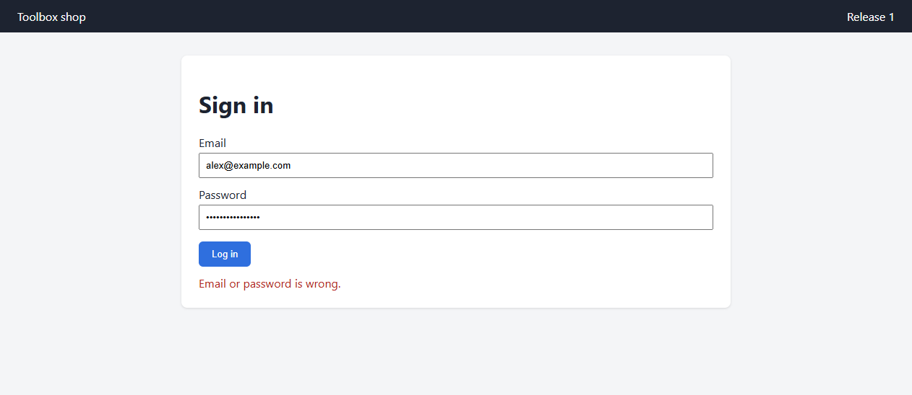
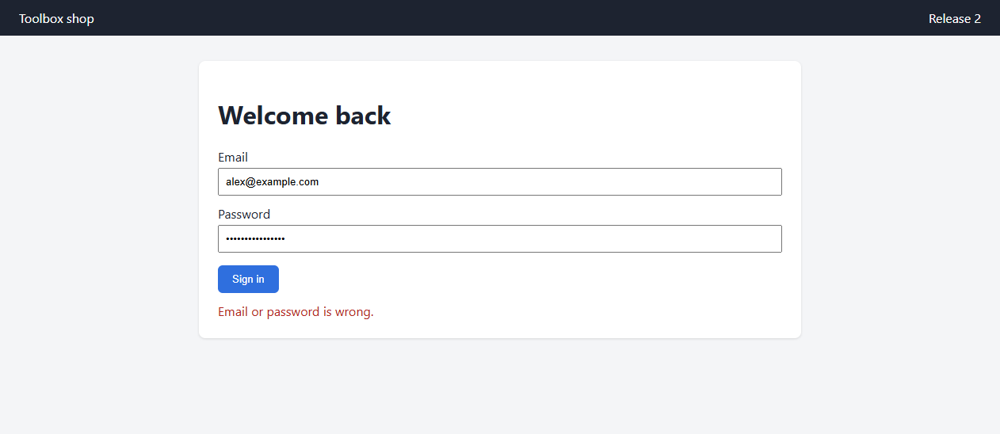
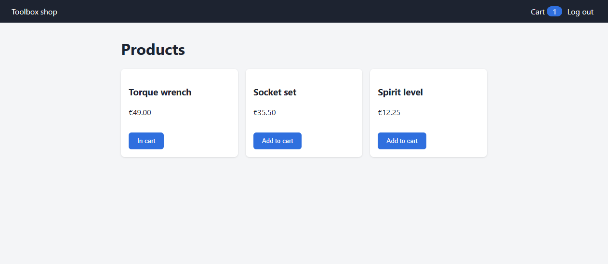
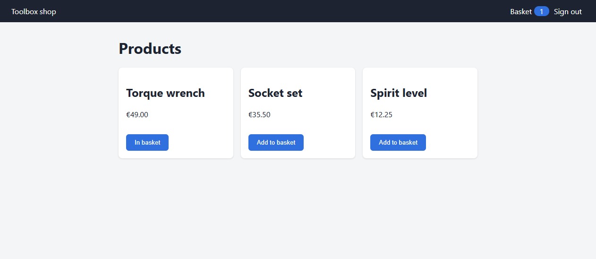
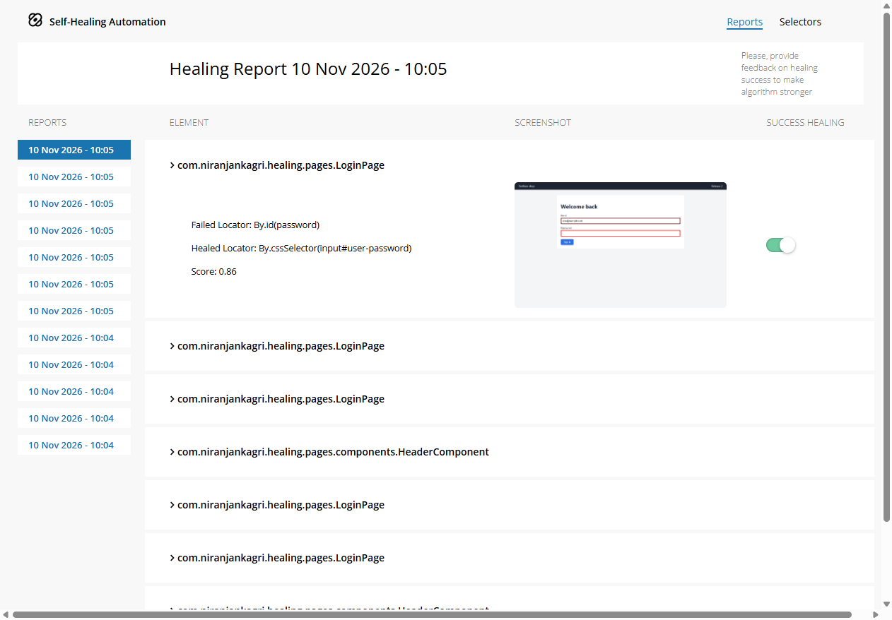
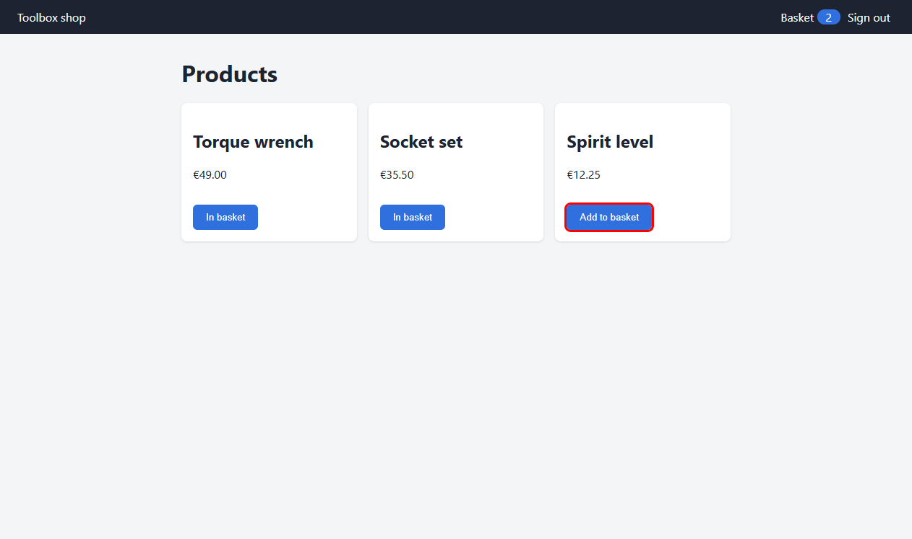

# Healenium self-healing tests

Selenium tests that keep running after a front-end redesign breaks their locators, using
[Healenium](https://healenium.io). The suite also shows where self-healing picks the **wrong** element, and adds
**controlled healing** on top: a heal is used only when it has a clear winner, a person reviews every heal, and a
review gate fails the run for heals nobody has looked at. A healed locator is not proof of a passed test.

A small demo shop ships two releases at the same URL. Release 2 renames or moves **every** locator the page objects
use. The same tests, through the same page objects, run on both:

| Step | Test class | Driver | Release | Result |
|---|---|---|---|---|
| 0. Rules | `HealingControlTest` | none | - | 18 unit tests of the guard, the reviewed-heals file and the gate |
| 1. Learn | `Release1LearningTest` | Healenium | 1 | 6 journeys pass, nothing healed; Healenium saves each element it found |
| 2. Day one | `Release2FirstReviewTest` | Healenium + guard, nothing reviewed | 2 | Heals with a clear winner are used; 2 ties stop (3 journeys pinned, see [Controlled healing](#controlled-healing)) |
| 3. After review | `Release2HealingTest` | Healenium + guard + reviewed heals | 2 | 16 approved heals used; the 2 wrong heals are rejected and stop instead of returning the wrong element |
| 4. Control | `Release2WithoutHealingTest` | plain ChromeDriver | 2 | 3 tests prove the old locators really fail without Healenium |
| 5. Gate | `HealReviewGateTest` | none | - | Day one: gate FAILS (7 heals used without review). After review: gate PASSES |

**41 tests, 0 failures**, about 1.5 minutes locally (Java 21, Chrome 158, Healenium backend in Docker).

## What release 2 changed

| Release 1 (what the tests were written for) | Release 2 (after the redesign) |
|---|---|
|  |  |
|  |  |

| Element | Release 1 | Release 2 |
|---|---|---|
| Email, password | `#email`, `#password` | `#user-email`, `#user-password` |
| Sign-in button | `#login-button` "Log in" | `#sign-in-button` "Sign in" |
| Error box | `div.error-message` in the form | `div.form-alert[role=alert]`, form wrapped in a new `div.card` |
| Product card | `div.product-card` > `h3.product-name`, `button.add-to-cart` | `article.catalog-item` > `h2.item-title`, `button.btn-add`, inside a new `section` |
| Cart link and badge | `a.cart-link`, `.cart-count` | `a.basket-link`, `.basket-badge` |
| Log out | `#logout` | `#sign-out` |
| Cart | `#cart-items tr.cart-row td.item-name`, `#cart-total`, `#checkout` | `#basket-lines tr.basket-line td.line-name`, `#basket-total`, `#place-order` |
| Confirmation | `#order-confirmation`, `#order-number` | `#thank-you`, `#order-ref` |
| Amount paid | `#order-total` | `#order-total` (unchanged: no healing needed) |

## Healed locators (real run)

What Healenium proposes on release 2, before any control (release 1.0 of this repo used every one of them). Built
by `scripts/healing-summary.sh` from Healenium's log lines; the heal journal of controlled healing records the same
targets and scores. "Times" counts lookups across all release 2 tests.

| Locator in the page object | Healed to | Score | Times |
|---|---|---:|---:|
| `By.id: email` | `input#user-email` | 0.86 | 7 |
| `By.id: password` | `input#user-password` | 0.86 | 7 |
| `By.id: login-button` | `button#sign-in-button` | 0.84 | 7 |
| `.cart-count` | `span.basket-badge` | 0.83 | 3 |
| `a.cart-link` | `a` | 0.87 | 1 |
| `By.id: logout` | `button#sign-out` | 0.82 | 1 |
| Torque wrench price (XPath by product name) | `article:nth-child(1) > p` | 1.00 | 1 |
| Spirit level price (XPath by product name) | `article:nth-child(3) > p` | 1.00 | 1 |
| Torque wrench add button, in `addToCart()` | `article:nth-child(1) > button` | 0.90 | 2 |
| Socket set add button, in `addToCart()` | `article:nth-child(2) > button` | 0.90 | 2 |
| **Torque wrench add button, in `buttonLabel()`** | **`article:nth-child(3) > button`** (wrong card) | 0.90 | 1 |
| **`.error-message`** | **`div.card`** (the new wrapper, not the error box) | 0.80 | 1 |
| Cart rows 1 and 2, item name | `tr:nth-child(1/2) > td:nth-child(1)` | 0.96 | 2 |
| `By.id: cart-total` | `strong#basket-total` | 0.95 | 1 |
| `By.id: checkout` | `button#place-order` | 0.69 | 1 |
| `By.id: order-confirmation` | `h1#thank-you` | 0.86 | 1 |
| `By.id: order-number` | `strong#order-ref` | 0.86 | 1 |

Healenium's own report (`http://localhost:7878/healenium/report`) lists every healing per browser session, with a
screenshot that marks the element and a switch to flag a wrong healing:



## Limits found on real runs

Three lookups go wrong with plain Healenium. They are the same on every run (the scoring is deterministic), so the
release 2 classes override those journeys and assert what really happens. If a Healenium upgrade changes the
outcome, those tests fail and this table needs an update. Release 1.0 of this repo let the wrong heals through and
relied on the journeys' assertions to catch them; with controlled healing they now stop before the test reads
anything.

| Test | Plain Healenium | Why | Controlled healing now | Lesson |
|---|---|---|---|---|
| `tc02` button label | After adding the torque wrench, its button label is read from the **spirit level's** button | After two clicks only the spirit level's button still reads "Add to basket" like the saved reference, so it wins **clearly** (0.897 against 0.781); the healed locator is positional | Rejected in review: the lookup stops (`STOPPED_REJECTED`) | A clear winner can still be wrong. Only a review catches it. Keep a stable hook (`data-testid`) on repeated items |
| `tc04` locked account | `isErrorShown()` says "no error" although the page shows one | It has `@DisableHealing` (an absence check must never heal into another element), so its out-of-date locator finds nothing | Unchanged: the lookup never reaches healing | A `@DisableHealing` check with a stale locator passes for the wrong reason. Pair it with a positive check, and fix the locator |
| `tc05` wrong password | The "error text" is the whole sign-in card | The form moved into a new `div.card`; the wrapper ties with other candidates (0.800 each) and takes the old path | Day one: stopped, no clear winner. After review: rejected, stopped | Structural moves heal worse than renames. Review every healed locator; never accept heals blindly |

Two more observations:

- Healenium keeps one reference per **locator and calling method**. The same XPath healed correctly in
  `addToCart()` and wrongly in `buttonLabel()`, because the two methods saved different snapshots of the button.
- It files each healing under the class that called `findElement`. A shared `find()` helper in `BasePage` made the
  whole report say `BasePage`, so the page objects now call `driver.findElement` themselves.

## Controlled healing

Plain Healenium uses the best-scoring element as soon as it scores at least `score-cap`. Two checks are added, in
`src/main/java/.../control`, following the flow "detect, compare, validate, retry, review":

1. **Clear winner.** Healenium already ranks every candidate; `GuardedHealingService` looks at that ranking after
   Healenium has picked. If the runner-up is within `healing.min-margin` (0.05) of the winner, the heal is stopped
   and the test gets `HealingStoppedException` (a `NoSuchElementException`) with the scores in the message.
2. **Reviewed heals.** `src/test/resources/healing/approved-heals.json` is the approved locator baseline: one entry
   per heal (page-object method, old locator, healed locator) with `approved` or `rejected` and a note. A rejected
   heal is stopped at once. A heal nobody has reviewed is used for this run, but the **review gate** fails the
   build and writes `target/healing/review-*-proposed.json`, entries ready for a person to fill in.

Every proposed heal, used or stopped, goes into the heal journal `target/healing/heals.json` with its evidence: the
test, the page-object method, old and new locator, the top 5 candidates with scores, the decision and why, and a
screenshot with the proposed element outlined. The gate's report `target/healing/review-*.md` goes into the CI job
summary; the whole folder is kept as a CI artifact.

**Why both checks: real scores on release 2.** The margin of 0.05 sits between the ties (gap 0.000) and the smallest
real gap of a correct heal (0.080, the email field).

| Heal | Best | Runner-up | Right element? | Clear-winner rule | Review |
|---|---:|---:|---|---|---|
| Three look-alike "Add to basket" buttons (`addToCart`) | 0.897 | 0.897 | Yes, but only because of the order Healenium lists ties in | Stops it | Approved (checked: article 1 is the torque wrench) |
| `.error-message` to the new `div.card` wrapper | 0.800 | 0.800 | **No** | Stops it | Rejected |
| Torque wrench button label to the spirit level's button | 0.897 | 0.781 | **No** | **Lets it through** | Rejected |
| All 14 other heals | | gap >= 0.080 | Yes | Lets them through | Approved |

So the clear-winner rule alone stops a heal that was right by luck and misses a confidently wrong one. A review
catches both. The review took three rounds, because each stopped heal hides the lookups after it in the journey.



*Evidence the journal saved for the rejected heal: the lookup for the **torque wrench's** button label, with the
element Healenium picked outlined, the spirit level's button.*

| Decision | When | Effect |
|---|---|---|
| `USED`, approved | Reviewed and approved | Test uses the element; gate counts it as approved |
| `USED`, not reviewed | Clear winner, no verdict yet | Test uses the element; **gate fails** and proposes an entry |
| `STOPPED_AMBIGUOUS` | No clear winner, no verdict | `HealingStoppedException`; listed for a person to fix |
| `STOPPED_REJECTED` | A reviewer rejected exactly this heal | `HealingStoppedException` with the reviewer's note |

A verdict covers one exact heal: if the page changes again and the same locator heals somewhere else, the new
target needs a fresh review (the report says what was approved before). The gate was also checked the other way:
with the `logOut` approval removed, the after-review gate failed with exactly that one heal to review.

Found on the way, both fixed in this repo:

- **`COLLECT_METRICS=true` (hlm-backend's default) uploads each healing's metrics, including the page DOM, to an
  EPAM endpoint on AWS** (`AmazonRestService` in hlm-backend 4.0.0 and 4.0.2, read from the images). Set to `false` in
  `infra/docker-compose.yml`. It is also why the runner-up scores never reach the local database: controlled
  healing reads them in the test JVM instead.
- **`backlight-healing` (healenium-web's default: on) draws a red border on every healed element and never removes
  it**, so the page under test changes. Switched off in `healenium.properties`; on this suite no score changed
  (checked heal by heal). The journal outlines the element only for its screenshot and restores it exactly.

## How it works

```
 test ──> page object ──> SelfHealingDriver.findElement(locator)
                               │ found? ── yes ──> save the element (tag, attributes, path) in hlm-backend
                               │
                               └── no ──> hlm-backend scores every element on the page against the saved one
                                          ──> selector-imitator builds a new locator for the best match
                                          ──> score >= score-cap (0.5)? proposed heal
                                          ──> GuardedHealingService: journal it, then
                                                rejected in review?         stop
                                                approved in review?         use it
                                                runner-up within 0.05?      stop
                                                otherwise                   use it (review gate fails the run)
```

| Part | Role |
|---|---|
| `healenium-web` 3.6.0 | `SelfHealingDriver.create(chromeDriver)` wraps the driver; settings in `src/test/resources/healenium.properties`. `DriverFactory` then swaps in `GuardedHealingService` with `engine.setHealingService(...)` |
| `hlm-backend` 4.0.0 | Saves reference elements in Postgres, scores candidates, serves the report |
| `hlm-selector-imitator` 1.6 | Turns the chosen element into a CSS locator |
| Postgres 18.6 | Storage; `docker compose down -v` forgets everything learned |

## Design

| Pattern | Where |
|---|---|
| Page Object Model | `pages/LoginPage`, `ProductsPage`, `CartPage`, `ConfirmationPage`: private locators, no `By` in any test |
| Component objects | `pages/components/HeaderComponent` (cart link, badge, log out), `ProductCard` (one tile, found by product name) |
| Fluent navigation | `signInAs(user)` returns `ProductsPage`, `openCart()` returns `CartPage`, `checkout()` returns `ConfirmationPage` |
| Driver factory | `driver/DriverFactory`: one switch between `SELF_HEALING` and `PLAIN`, headless by default |
| Test data objects | `data/User` (`customer()`, `locked()`, `wrongPassword()`), `data/Product` (name, price) |
| Base classes | `BasePage` (page waits), `BaseTest` (shop, release, browser per test, screenshot on failure) |
| Template tests | `ShopJourneys` holds the journeys once; the release classes only say which release and which driver |
| Test back door | `app/ShopSession` signs in through `sessionStorage` for the control test, whose sign-in form is broken |
| Decorator (by subclassing) | `control/GuardedHealingService` extends Healenium's `HealingService`: Healenium's healing first, then the policy |
| Policy / rules object | `control/HealingPolicy` (settings), `control/HealGuard` (the rules, no Selenium, unit tested) |
| Value objects | `HealKey`, `HealRecord`, `Candidate`, `ReviewedHeals.Entry` (records) |
| Approved baseline as data | `src/test/resources/healing/approved-heals.json`, reviewed in pull requests like code |
| Gate | `control/ReviewGate`: verdict, Markdown report, proposals for heals that still need a verdict |

## Run it

Needs Java 21+, Chrome and Docker.

```bash
docker compose -f infra/docker-compose.yml up -d --wait   # Postgres, hlm-backend :7878, selector-imitator :18000
./mvnw verify                                            # all 15 tests, in the order of src/test/resources/testng.xml
open http://localhost:7878/healenium/report              # the healing report
docker compose -f infra/docker-compose.yml down -v       # stop and forget what was learned
```

- `-Dheadless=false` shows the browser. `-Dheal-enabled=false` switches healing off (release 2 then fails).
- `-Dhealing.min-margin=0.05` sets the clear-winner gap. `-Dhealing.approvals=path` uses another reviewed-heals file.
  `-Dhealing.guard=observe` records what the guard would stop but stops nothing (used to measure the scores above;
  the release 2 tests that expect a stop then fail).
- After a run: `target/healing/review-*.md` (the gate's verdicts), `heals.json`, `screenshots/`.
- The selector-imitator is published on host port **18000**, not 8000: Windows with Hyper-V often reserves
  7914-8013, and Docker then cannot bind 8000.
- README screenshots: `src/test/java/.../tools/ReadmeScreenshots.java` (run after a test run; command in its Javadoc).

## Gotchas found while building it

| Problem | Fix |
|---|---|
| Surefire ran **0 tests** | healenium-web 3.6.0 publishes JUnit 5 and Testcontainers with compile scope, so Surefire picked the JUnit Platform. Excluded in `pom.xml` |
| `NoClassDefFoundError: com/google/inject/Injector` on the first healing | Healenium scans every class in the call stack for `@DisableHealing`; TestNG classes there refer to Guice, optional since TestNG 7.12. Guice added as a test dependency |
| `suiteXmlFiles is not supported since 3.6.0` | Surefire 3.6 runs TestNG on the JUnit Platform and ignores suite files. Pinned to 3.5.6 (as in the other TestNG repos) |
| `ClassCastException` taking a failure screenshot | `SelfHealingDriver` is a proxy without `TakesScreenshot`; the screenshot is taken from `getDelegate()` |

## Project layout

```
infra/docker-compose.yml        Healenium backend: Postgres, hlm-backend, selector-imitator (pinned, health checks)
src/main/resources/shop/v1, v2  The two releases of the demo shop (static HTML + JS)
src/main/java/.../app           DemoShop (JDK HTTP server, deploy(release) at the same URL), Release, ShopSession
src/main/java/.../driver        DriverFactory
src/main/java/.../pages         Page objects and components (release 1 locators)
src/main/java/.../control       Controlled healing: guard, policy, heal journal, reviewed heals, review gate
src/main/java/.../data          User, Product
src/test/java/.../control       HealingControlTest (rules, no browser)
src/test/java/.../tests         BaseTest, ShopJourneys, the four release test classes, HealReviewGateTest
src/test/resources              testng.xml (order), healenium.properties, simplelogger.properties
src/test/resources/healing      approved-heals.json: the reviewed heals (approved locator baseline)
scripts/healing-summary.sh      Healed-locator table from the Maven output
```

## License

MIT
